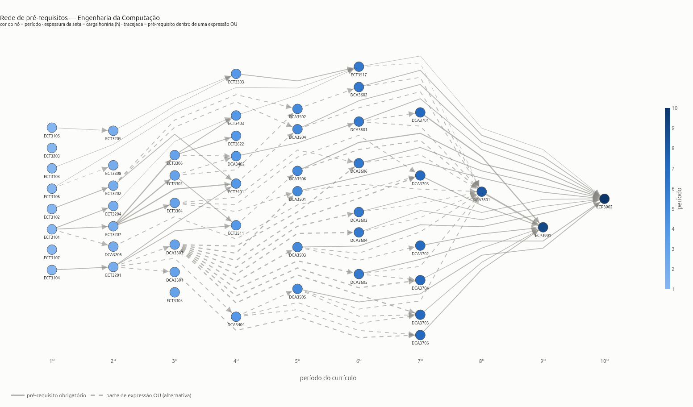
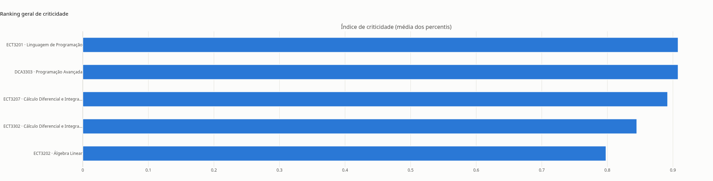
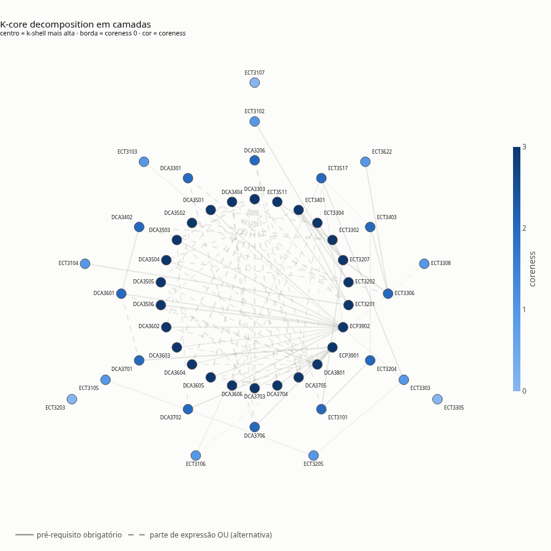
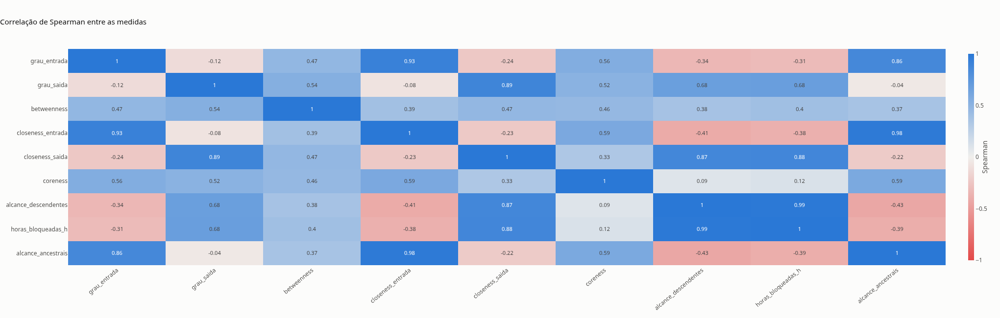

# Rede de pré-requisitos — Engenharia da Computação (UFRN)

Análise de rede da grade curricular obrigatória de Engenharia da Computação da UFRN, para descobrir quais disciplinas são os principais pontos críticos do curso.

Projeto da disciplina **Algoritmos e Estruturas de Dados II**.

## Integrantes

Israel Soares de Castro Filho

## Vídeo

https://youtu.be/g4j8cal7PdA

## Problema e pergunta

Um curso de graduação é organizado em períodos, e muitas disciplinas só podem ser cursadas depois de pagar seus **pré-requisitos**. Reprovar ou adiar uma disciplina pode travar várias outras e, no pior caso, atrasar a formatura. Como essas dependências são relações entre pares de disciplinas (A é pré-requisito de B), o currículo é naturalmente uma **rede**.

> **Pergunta:** quais disciplinas obrigatórias de Engenharia da Computação (UFRN) são os principais pontos críticos do currículo — as que mais bloqueiam outras, ligam o início ao fim do curso ou concentram conexões?

"Crítico" pode ter vários sentidos, então a pergunta foi desdobrada em quatro, cada uma respondida por um tipo de medida da rede:

| Sentido de "crítico" | Pergunta | Medidas usadas |
|---|---|---|
| Gargalo imediato | quem tem mais disciplinas dependendo diretamente dela? | grau de saída |
| Efeito cascata | quanto do curso trava se ela não for cumprida? | alcance (descendentes) e horas bloqueadas |
| Ponte | quem fica no meio dos caminhos entre o básico e o avançado? | betweenness e closeness |
| Núcleo denso | quais formam o bloco mais interligado do currículo? | k-core, k-shell e coreness |

Há ainda uma pergunta de planejamento: **qual é a maior cadeia de pré-requisitos**, que impõe um mínimo de períodos para se formar.

A rede ajuda porque mostra o que está *além* dos pré-requisitos diretos: dependências de dependências, caminhos que passam por uma disciplina e blocos densos de disciplinas interligadas. Uma lista de disciplinas não mostra isso.

## Dados (fonte, como obter, limpeza)

**Fonte.** Dados reais e públicos do currículo de Engenharia da Computação da UFRN, disponíveis no SIGAA (`sigaa.ufrn.br`): disciplinas, carga horária, período e texto de pré-requisitos. Coletados apartir do script em python da pasta `we_scrapping/`

**Como obter.** Os arquivos já estão no repositório, em `dados/raw/`:

| Arquivo | Uma linha é… | Colunas principais |
|---|---|---|
| `disciplinas.csv` | uma disciplina (170 linhas: 50 obrigatórias, 118 optativas e 2 complementares) | `codigo`, `nome`, `ch` (carga horária), `natureza`, `nivel` (período) e as colunas brutas de pré-requisitos, co-requisitos e equivalências |
| `arestas.csv` | um pré-requisito (87 linhas) | `pre_requisito` → `disciplina` e `alternativa` |

As arestas foram extraídas do texto bruto de pré-requisitos de cada disciplina. A coluna `alternativa` vale 1 quando o texto traz um **"OU"** com uma opção **fora da grade atual** (código de currículo antigo ou disciplina equivalente de outro curso). Exemplo: Eletrônica (`DCA3506`) tem pré-requisito `ECT3511 OU DCA0105`. A `DCA0105` não é mais ofertada, mas segue aceita para quem a cursou antes da mudança de currículo. Só `ECT3511`, que pertence à grade, vira aresta.

**Limpeza e validação** (célula de leitura do notebook):

- remoção de espaços extras nas colunas de texto;
- `nivel` vazio (optativas e complementares) vira 0;
- nomes padronizados (capitalização, preposições em minúsculas e algarismos romanos);
- conferência de códigos repetidos (0), arestas repetidas (0), laços `A → A` (0) e códigos de aresta ausentes em `disciplinas.csv` (0);
- conferência de que `alternativa` bate com o "OU" do texto bruto (46 de 87 arestas, sem inconsistências);
- conferência de que nenhum grupo "OU" tem duas disciplinas da grade (33 grupos, 0 casos), o que confirma que o "OU" sempre aponta para fora da grade.

## Modelagem (nó, aresta, peso, direção, o que ficou de fora)

| Elemento | Definição |
|---|---|
| **Nó** | disciplina **obrigatória**, identificada pelo código. Atributos: `nome`, `ch`, `natureza`, `nivel` |
| **Aresta** | `A → B` quando A é pré-requisito de B |
| **Direção** | sim: da disciplina-base (A) para a que depende dela (B) |
| **Peso** | carga horária (h) da **origem** (o pré-requisito); varia de 30 a 120 h. Dá para trocar para a do destino em `PESO_DA_ARESTA` |
| **Atributo `alternativa`** | 1 quando existe uma alternativa "OU" fora da grade. É só informativo e não altera a estrutura do grafo |

O grafo é **dirigido, ponderado e simples**, e é um **DAG** (sem ciclos), o que o código verifica. Toda aresta é um pré-requisito da grade atual, válido para quem segue o currículo vigente.

**O que ficou de fora:**

- **Co-requisitos e equivalências:** não bloqueiam a matrícula do mesmo jeito que um pré-requisito.
- **Optativas e complementares:** o CSV não traz pré-requisitos para elas e entrariam como nós soltos (`INCLUIR_OPTATIVAS = True` as inclui).
- **Alternativas "OU" fora da grade:** códigos antigos e equivalentes de outros cursos não são nós do grafo, pois não fazem parte do currículo atual.

## Conteúdo do curso utilizado

"cél." é o número da célula de código no `projeto.ipynb` ao rodar *Run All* (o `In [n]` do Jupyter). As seções citadas são as do notebook.

| conceito | semana | onde aparece | para que serviu |
|---|---|---|---|
| Grafo dirigido, ponderado e DAG (`nx.DiGraph`) | 2 | `projeto.ipynb`, seção 3.5, cél. 6 | modelar o currículo: nó = disciplina, aresta = pré-requisito, peso = carga horária |
| Atributos de nós e arestas | 2 | `projeto.ipynb`, seção 3.5, cél. 6 | guardar nome, carga horária, período, peso e a marca de alternativa fora da grade |
| Densidade (`nx.density`) | 2 | `projeto.ipynb`, seção 3.5, cél. 6 | medir o quão esparsa é a rede |
| Subredes (`G.subgraph`, `nx.k_core`) | 2 | `projeto.ipynb`, seção 4.6, cél. 15 e 16 | isolar o núcleo e comparar com o resto |
| Grau, grau de entrada e de saída (`in_degree`, `out_degree`) | 2 e 3 | `projeto.ipynb`, seção 4.3, cél. 10 a 12 | achar gargalos imediatos e disciplinas que dependem de muitas |
| Matriz de adjacência (nilpotente em DAG) | 2 | `projeto.ipynb`, seção 4.9, cél. 20 | justificar por que o autovetor foi descartado |
| Alcançabilidade por travessia (BFS dentro de `descendants` e `ancestors`) | 3 | `projeto.ipynb`, seção 4.7, cél. 18 | medir o efeito cascata: quantas disciplinas ficam bloqueadas |
| Núcleo e periferia | 3 | `projeto.ipynb`, seção 4.6, cél. 15 a 17 | separar o miolo interligado das pontas |
| Caminhos e distâncias | 4 | `projeto.ipynb`, seções 4.4 e 4.5, cél. 13 e 14 | base de betweenness e closeness |
| Centralidade de grau (normalizada) | 4 | `projeto.ipynb`, seção 4.3, cél. 10 | comparar graus em escala de 0 a 1 |
| Betweenness | 4 | `projeto.ipynb`, seção 4.4, cél. 13 | achar disciplinas-ponte entre o básico e o avançado |
| Closeness | 4 | `projeto.ipynb`, seção 4.5, cél. 14 | medir quem alcança, ou é alcançada por, muitas disciplinas rapidamente |
| Componentes fracos e fortes, GCC | 4 | `projeto.ipynb`, seções 3.5 e 4.9, cél. 6 e 20 | achar os blocos separados e os isolados; mostrar que um DAG não é fortemente conexo |
| Visualização de redes | 4 | `projeto.ipynb`, seção 3.6, cél. 8, 12, 16 e 17 | desenhar o currículo por período, com cor e espessura |
| K-core, k-shell, core number e degeneracy | 5 | `projeto.ipynb`, seção 4.6, cél. 15 | separar o núcleo densamente interligado da periferia |
| Camadas de cebola (layout concêntrico por k-shell) | 5 | `projeto.ipynb`, seção 4.6, cél. 17 | visualizar núcleo × periferia |
| Excentricidade, diâmetro, periferia, centro e autovetor | 2 e 4 | `projeto.ipynb`, seção 4.9, cél. 20 | **avaliados e descartados**, com a justificativa no notebook |
| Caminho crítico em DAG (programação dinâmica na ordem topológica) | método próprio | `projeto.ipynb`, seção 4.7, cél. 18 | medir a cadeia que atrasa a formatura |
| Índice de criticidade (média de percentis) e correlação de Spearman | método próprio | `projeto.ipynb`, seção 4.8, cél. 19 | consolidar critérios e ver onde as medidas discordam |

## Como executar

**Requisitos:** Python 3.11 ou superior.

**Estrutura esperada:**

```text
.
├── projeto.ipynb
├── requirements.txt
├── README.md
└── dados/
    ├── raw/                # entrada: disciplinas.csv e arestas.csv
    ├── processed/          # saída: metricas_disciplinas.csv e figuras de ranking
    └── grafos/             # figuras dos grafos
```

**Passos:**

```bash
# 1. clonar o repositório e entrar na pasta
git clone <URL-DO-REPOSITORIO>
cd <PASTA-DO-REPOSITORIO>

# 2. (opcional) criar um ambiente virtual
python -m venv .venv
source .venv/bin/activate        # Windows: .venv\Scripts\activate

# 3. instalar as dependências
pip install -r requirements.txt

# 4. abrir o notebook
acessar arquivo projeto.ipynb
```

No Jupyter, use **Run → Run All Cells**. Os caminhos são relativos à pasta do notebook, então abra-o a partir da raiz do repositório.

O notebook gera `dados/processed/metricas_disciplinas.csv`, com todas as medidas de cada disciplina. As figuras são interativas (plotly); as imagens abaixo são versões estáticas exportadas delas.

As decisões de modelagem ficam em uma célula no início da seção 3 do notebook: `INCLUIR_OPTATIVAS`, `PESO_DA_ARESTA` e `TOP_N`.

## Resultados

### A rede em números

| | |
|---|---|
| Disciplinas (nós) | 50 obrigatórias |
| Pré-requisitos (arestas) | 87, sendo 46 com alternativa "OU" fora da grade |
| Carga horária total | 3.014 h |
| Tipo | DAG (sem ciclos) |
| Densidade | 0,0355 (rede esparsa) |
| Componentes fracamente conexos | 4, sendo 3 disciplinas isoladas (`ECT3107`, `ECT3203`, `ECT3305`); as outras 47 formam um único bloco |
| Maior cadeia de pré-requisitos | 7 disciplinas, em 10 períodos |
| Degeneracy (k-core máximo) | 3 |



*Figura 1 — Rede de pré-requisitos por período. Cor do nó = período; espessura da seta = carga horária; seta tracejada = pré-requisito que tem alternativa fora da grade. As setas se concentram em `DCA3801`, `ECP3901` e `ECP3902`, no fim do curso.*

### Resposta à pergunta

Os pontos críticos aparecem em quatro grupos, cada um por um motivo diferente:

**1. A fundação que trava o curso inteiro (efeito cascata).** `ECT3101` (Matemática Básica e Modelagem), `ECT3104` (Lógica de Programação), `ECT3201` (Linguagem de Programação) e `ECT3207` (Cálculo I) bloqueiam, direta ou indiretamente, de **21 a 24 das outras 49 disciplinas**, o que equivale a 1.499 a 1.679 h. `ECT3101` lidera, com 24 disciplinas e 1.679 h. São de 1º e 2º períodos, então um atraso ali se propaga por todo o curso.

**2. Os hubs e pontes do meio do curso.** `DCA3303` (Programação Avançada) tem o maior grau de saída, com **9 dependentes diretos**. `ECT3201` (5) e `ECT3207` (4) completam o trio de maior grau de saída. Os três estão entre as cinco maiores betweenness e ligam o básico ao avançado.

**3. Os pontos de convergência do fim do curso.** `DCA3801` (Projeto Integrado) exige **12 pré-requisitos diretos** e tem a maior betweenness da rede, junto de `ECT3517`. `ECP3902` (Estágio, 12) e `ECP3901` (TCC, 7) têm os maiores graus de entrada. Elas quase não travam outras disciplinas: são as que mais sofrem com atrasos anteriores.

**4. O núcleo denso.** O 3-core tem **26 disciplinas (52 %)**, 17 `DCA`, 7 `ECT` (`ECT3201`, `ECT3202`, `ECT3207`, `ECT3302`, `ECT3304`, `ECT3401` e `ECT3511`) e `ECP3901` e `ECP3902`. Há 12 disciplinas na 2-shell, 9 na 1-shell e 3 na 0-shell (as isoladas). Nem todas as que mais bloqueiam estão no núcleo: `ECT3101` está na 2-shell e `ECT3104` na 1-shell.

**Caminho crítico (planejamento).** A cadeia mais pesada tem **619 h** e 7 disciplinas:

`ECT3101 → ECT3207 → ECT3302 → ECT3511 → DCA3506 → DCA3801 → ECP3901`

| Disciplina | Período | Grau de saída | Grau de entrada | Alcance (descendentes) | Horas bloqueadas | Betweenness | Coreness | Índice de criticidade |
|---|---|---|---|---|---|---|---|---|
| `ECT3101` Matemática Básica e Modelagem | 1 | 3 | 0 | 24 | 1.679 | 0,0000 | 2 | 0,590 |
| `ECT3104` Lógica de Programação | 1 | 1 | 0 | 23 | 1.634 | 0,0000 | 1 | 0,410 |
| `ECT3201` Linguagem de Programação | 2 | 5 | 1 | 22 | 1.574 | 0,0094 | 3 | 0,908 |
| `ECT3207` Cálculo Diferencial e Integral I | 2 | 4 | 1 | 21 | 1.499 | 0,0070 | 3 | 0,892 |
| `DCA3303` Programação Avançada | 3 | 9 | 1 | 13 | 980 | 0,0096 | 3 | 0,908 |
| `ECT3517` Ciências e Tecnologias Aplicadas 3 | 6 | 2 | 3 | 3 | 440 | 0,0097 | 2 | 0,605 |
| `DCA3801` Projeto Integrado | 8 | 1 | 12 | 1 | 160 | 0,0102 | 3 | 0,582 |

### Ranking geral e núcleo



*Figura 2 — Índice de criticidade (média dos percentis de grau de saída, betweenness, alcance e coreness). Topo: `ECT3201` e `DCA3303` (0,908), `ECT3207` (0,892), `ECT3302` (0,845) e `ECT3202` (0,798).*

O índice **subestima a fundação**: `ECT3101` (0,590) e `ECT3104` (0,410) são início de cadeia, com betweenness 0 e coreness baixa, apesar de bloquearem 24 e 23 disciplinas. Por isso a resposta não deve se apoiar só no índice: o alcance mostra o que ele esconde.



*Figura 3 — Decomposição em k-cores em camadas: a k-shell mais alta fica no centro e a coreness 0 na borda. Cor = coreness.*



*Figura 4 — Correlação de Spearman (entre rankings) das medidas.*

A correlação mostra que as medidas respondem a perguntas diferentes:

- **Grau de saída, closeness de saída e alcance andam juntos** (0,68 a 0,89): quem tem muitos dependentes diretos costuma travar muita coisa no total.
- **Coreness quase não se relaciona com alcance** (0,09): estar no núcleo denso não significa bloquear mais.
- **As medidas de entrada têm correlação negativa com o alcance** (−0,34 a −0,43): o currículo tem um lado "base", que bloqueia, e um lado "fim", que depende.
- **Betweenness tem correlação moderada com quase tudo** (0,37 a 0,54): é um terceiro tipo de importância, a de quem está no meio do caminho.
  
## Limitações e próximos passos

**Limitações**

- A rede descreve a **estrutura do currículo**, não o comportamento dos alunos (reprovações, oferta de turmas, trancamentos). "Crítica" quer dizer *estruturalmente importante*, não *difícil*.
- As alternativas "OU" fora da grade (códigos antigos e equivalentes de outros cursos) não entram na rede. Um aluno que cursou um equivalente pode não depender daquela aresta, então para ele o efeito cascata real é menor.
- Co-requisitos, equivalências, optativas e complementares ficaram de fora.
- O peso é a carga horária, que varia pouco (30 a 120 h) e muda pouco o ranking.
- Com 50 nós, o ranking entre posições vizinhas é frágil. Por isso a conclusão se apoia em grupos de disciplinas e em vários critérios.
- Excentricidade, diâmetro e centralidade de autovetor não puderam ser calculados: um DAG não é fortemente conexo e sua matriz de adjacência é nilpotente.

## Referências

- SIGAA UFRN — estrutura curricular do curso de Engenharia da Computação: https://sigaa.ufrn.br
- Material das aulas da disciplina Algoritmos e Estruturas de Dados II (Semanas 2 a 6).
- Hagberg, A. A.; Schult, D. A.; Swart, P. J. *Exploring network structure, dynamics, and function using NetworkX*. Proceedings of the 7th Python in Science Conference (SciPy), 2008, p. 11–15.
- Seidman, S. B. *Network structure and minimum degree*. Social Networks, 5(3), 1983, p. 269–287. (k-core)
- Freeman, L. C. *A set of measures of centrality based on betweenness*. Sociometry, 40(1), 1977, p. 35–41.
- Wasserman, S.; Faust, K. *Social Network Analysis: Methods and Applications*. Cambridge University Press, 1994. (correção de closeness para grafos desconexos)
- Documentação de NetworkX (https://networkx.org), plotly (https://plotly.com/python/) e pandas (https://pandas.pydata.org).